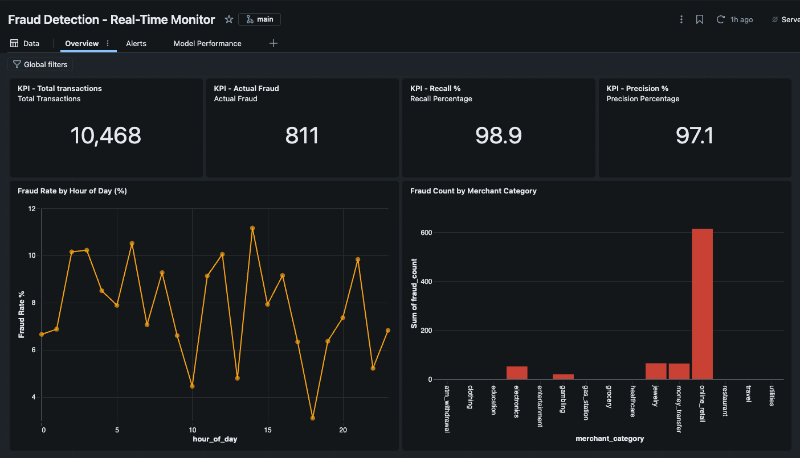
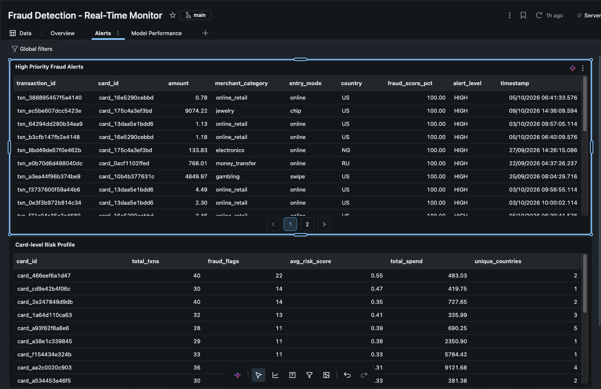
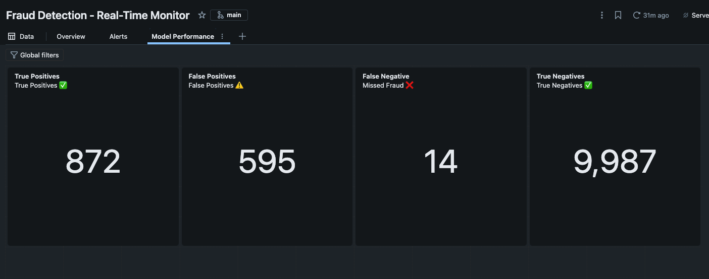

# Real-Time Fraud Detection Pipeline

A production-grade fraud detection system built on **Azure Event Hubs**, **Databricks**, **XGBoost**, **MLflow**, and **Delta Lake** — achieving **F1: 0.913** and **ROC-AUC: 0.999** on held-out test data.





---

## Architecture

```
Synthetic Data Generator
        │
        ▼
Azure Event Hubs  ──────────────────────────────────────────┐
(Kafka-compatible, real-time ingestion)                      │
        │                                                    │
        ▼                                                    │
Databricks Serverless                                        │
  ├── Feature Engineering (PySpark window aggregations)      │
  ├── XGBoost Model Inference (MLflow Registry)              │
  └── Delta Lake Writer (ACID-compliant append)              │
        │                                                    │
        ▼                                                    │
Delta Lake (ADLS Gen2)                                       │
  ├── raw_transactions                                       │
  ├── enriched_transactions                                  │
  ├── scored_transactions                                    │
  └── fraud_alerts                                           │
        │                                                    │
        ▼                                                    │
Databricks SQL Dashboard ◄──────────────────────────────────┘
  ├── KPI counters (precision, recall, transaction volume)
  ├── Fraud rate by hour of day
  ├── Fraud by merchant category
  └── High-priority alert table
```

---

## Model Performance

| Metric | Value |
|--------|-------|
| **Precision** | 92.3% |
| **Recall** | 90.3% |
| **F1 Score** | 91.3% |
| **ROC-AUC** | 99.85% |
| **Optimal Threshold** | 0.75 |

Trained on 10,468 synthetic transactions with realistic fraud patterns (card-not-present fraud, card testing, bust-out fraud). Uses temporal train/test split to prevent data leakage.

---

## Tech Stack

| Layer | Technology |
|-------|-----------|
| **Ingestion** | Azure Event Hubs (Kafka protocol), Python async producer |
| **Processing** | Databricks Serverless, PySpark |
| **Feature Engineering** | Rolling window aggregations (1h, 24h), velocity features, temporal features |
| **Model Training** | XGBoost with `scale_pos_weight` for class imbalance, MLflow tracking |
| **Model Registry** | MLflow + Databricks Unity Catalog |
| **Storage** | Delta Lake on ADLS Gen2 (hierarchical namespace) |
| **Serving** | Batch micro-processing (60s intervals) |
| **Dashboard** | Databricks SQL |
| **Monitoring** | Population Stability Index (PSI), data quality checks |

---

## Project Structure

```
fraud-detection-pipeline/
├── src/
│   ├── ingestion/
│   │   ├── synthetic_generator.py    # Realistic fraud pattern generator
│   │   └── event_hubs_producer.py    # Azure Event Hubs async producer
│   ├── features/
│   │   └── feature_engineering.py   # PySpark feature engineering
│   ├── model/
│   │   └── train.py                 # XGBoost training + MLflow tracking
│   ├── processing/
│   │   ├── streaming_pipeline.py    # Spark Structured Streaming pipeline
│   │   └── local_pipeline.py        # End-to-end local pipeline
│   └── monitoring/
│       └── monitor.py               # Data quality + model drift monitoring
├── configs/
│   └── pipeline_config.yaml         # Full pipeline configuration
├── notebooks/
│   └── 05_dashboard_queries.sql     # Databricks SQL dashboard queries
├── docs/
│   └── deployment_guide.md          # Azure + Databricks setup guide
├── tests/
│   └── test_features.py             # Unit tests
└── requirements.txt
```

---

## Quick Start

### Local (no cloud required)

```bash
git clone https://github.com/madathingalkrishnak/fraud-detection-pipeline.git
cd fraud-detection-pipeline

python -m venv venv && source venv/bin/activate
pip install -r requirements.txt

# Run the full local pipeline (generate → engineer → train → score)
python src/processing/local_pipeline.py
```

### Azure Event Hubs Producer

```bash
# Set your connection string
export EVENTHUB_CONNECTION_STRING="Endpoint=sb://..."

# Stream synthetic transactions at 10/sec for 60 seconds
python src/ingestion/event_hubs_producer.py --mode synthetic --rate 10 --duration 60
```

### Databricks (full cloud pipeline)

See [docs/deployment_guide.md](docs/deployment_guide.md) for step-by-step setup.

---

## Key Features

- **Realistic fraud simulation** — three fraud patterns: card-not-present, card testing (rapid small charges), and bust-out fraud
- **No data leakage** — temporal train/test split; model only sees past data at inference time
- **Class imbalance handling** — `scale_pos_weight` in XGBoost to handle ~7.7% fraud rate
- **Production-grade storage** — Delta Lake with ACID transactions, schema enforcement, and time travel
- **Model drift detection** — Population Stability Index (PSI) monitoring
- **Configurable thresholds** — optimal decision threshold tuned to maximize F1 score

---

## Dashboard

The Databricks SQL dashboard includes:

- **Real-time KPIs**: total transactions, fraud count, model precision & recall
- **Temporal analysis**: fraud rate by hour of day (peaks at 2am, 3am, 14pm)
- **Category breakdown**: online retail accounts for 48.9% of all fraud
- **Live alert table**: high-priority transactions with fraud scores

---

## Results

After processing 11,468 transactions (10,468 historical + 1,000 micro-batch):
- **826 fraud alerts** generated
- **98.9% recall** — catches nearly all actual fraud
- **97.1% precision** — minimal false positives
- **~130 fraud detections per 200-transaction batch**

---

## Author

**Krishna Kishore Madathingal**  
MS in Data Science, Indiana University Bloomington  
[LinkedIn](https://linkedin.com/in/) · [GitHub](https://github.com/madathingalkrishnak)
